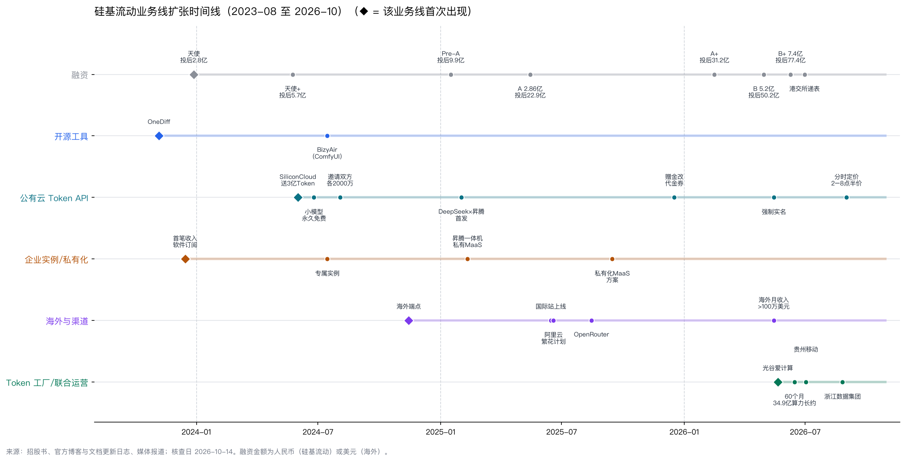
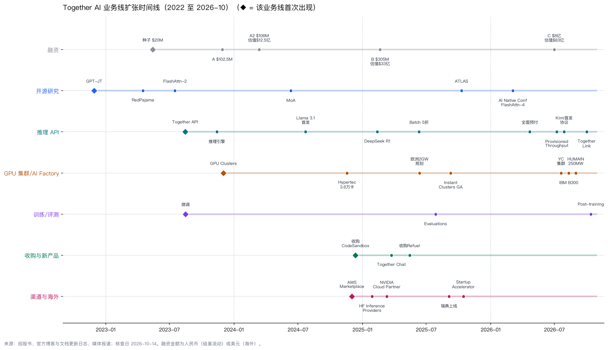
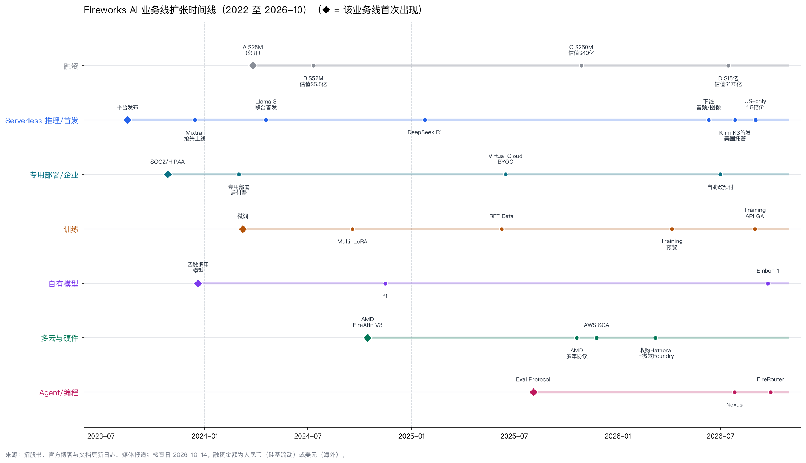

核查日期：2026-10-14（Asia/Shanghai）。仅供内部使用，含竞品名，不对外。

证据标记：

- **【招股书】** 港交所申请版本原文
- **【官】** 公司官网、博客、文档、招聘页
- **【投】** 投资方发布
- **【媒】** 媒体报道
- **【三方】** Sacra 等第三方估算
- **【传】** 匿名信源报道
- **【算】** 本报告用上述数字相除或相加得出
- **【判断】** 本文分析

金额一律照原币种列出，不做汇率换算。查不到的写"未查到"。

为什么选这三家：硅基流动是国内同类里唯一公开招股书的；Together AI 和 Fireworks AI 是海外估值最高的两家独立开源模型推理平台。海外的 Baseten（估值 130 亿美元）和偏能源侧的 Crusoe 也可以按同样框架补做。

## 0. 先看结论

### 一张表看四家（含上一份的无问芯穹作参照）

| | 硅基流动 | Together AI | Fireworks AI | 无问芯穹（参照） |
|---|---|---|---|---|
| 成立 | 2023-08，北京 | 2022-06，旧金山 | 2022，加州 | 2023-05，上海 |
| 核心生意 | Token API 加本地部署软件，2026 年起加"Token 工厂"联合运营 | GPU 集群出租加开源模型推理 API，覆盖训练到推理全周期 | 开源模型推理，加上用客户自有数据训练专用模型 | 异构算力云、Token API、政府和国资算力平台 |
| 最新估值 | 投后 77.4 亿元（B+ 轮，2026-06）【招股书】 | 投后 83 亿美元（C 轮，2026-07）【官】 | 投后 175 亿美元（D 轮，2026-07）【官】 | 上市前约 143 亿元【传】 |
| 收入口径 | 2025 年 5,533 万元（审计）【招股书】 | 上季度年度 bookings 超过 11.5 亿美元【官】；年化收入 12 亿美元【媒·NYT】 | 年化收入超过 10 亿美元，同比约 5 倍【官】 | 2024 年超过 8,500 万元（清华材料，非审计） |
| 估值约为收入的几倍【算】 | 约 140 倍（对 2025 年收入） | 约 7 倍（对年化收入） | 约 17.5 倍（对 ARR） | 不可比 |
| 毛利 | 总体 −24.0%；公有云 −119.0%；本地部署 82.5%【招股书】 | 约 45%【三方·Sacra】 | 约 50%【媒·The Information 转述】；CEO 称 30–40%（节目摘要） | 未披露 |
| 盈亏 | 2025 年净亏损 3.45 亿元【招股书】 | 未披露 | 未披露 | 未披露 |
| 股权融资合计 | 约 19.5 亿元，7 轮【算·招股书】 | 约 13.3 亿美元，5 轮【算】 | 约 18.3 亿美元，4 轮【算】 | 43 亿元【媒】 |
| 算力从哪来 | 以短租第三方为主，正转长约；2026-06 签 60 个月、总价 34.91 亿元的算力协议【招股书】 | 租赁加伙伴共建（Hypertec、IBM、HUMAIN）；C 轮另有新投资人在表外承担 500 MW 以上的算力投资【官】 | 不自有，从 20 多家云租用（Oracle、AWS、Crusoe、微软、AMD）【媒/官】 | 长租第三方，三份长约合计 7.35 亿元 |
| 上市 | 2026-06-30 按港交所 18C 章递表，尚未聆讯【招股书/披露易】 | 未见 S-1 | 未见 | 据传已秘密递表港交所 |
| 和沐仞的关系【判断】 | **国内正面对手**：API、联合运营分润、出海三条线都重叠；同时是**电站侧算力的潜在买家** | **海外替代品**：沐仞出海卖中国模型，客户的另一个选择就是它 | **海外替代品**：同上；它的算力供应商里有能源型云 Crusoe | 国内对手兼潜在买家 |

### 你的几个问题，三家各自的答案

- **产品线怎么扩张的？**
  - 硅基流动：开源加速工具 → 公有云 API → 企业专属实例和私有化 → 海外 → 联合运营"Token 工厂"。
  - Together：开源研究 → API → GPU 集群 → 训练和评测 → 收购代码沙箱与数据工具 → AI Factory。
  - Fireworks：推理 API → 专用部署 → 训练闭环 → 多云 → 抢企业的 AI 编程预算（第 2、3、4 节有泳道图）。
- **主要怎么赚钱？**
  - 硅基流动：2025 年收入一半来自公有云（按 Token 计费和专属实例），一半来自本地部署软件。只有本地部署赚钱。
  - Together：第三方估算大头是 GPU 集群出租，API 约占三到四成。
  - Fireworks：按 Token 计费、按 GPU 秒计费、预留容量和训练。
- **赚的钱多吗？**
  - 硅基流动：小。2025 年收入 5,533 万元，净亏 3.45 亿元。
  - Together 和 Fireworks：年化收入都已超过 10 亿美元，但都没有公开利润。
- **是不是纯靠融资？**
  - 硅基流动：基本是。经营现金流 −1.72 亿元，靠 7 轮融资维持。
  - Together 和 Fireworks：收入已经是真钱，但扩张算力仍然靠融资和表外资本。
- **为什么能融这么多？**
  - Fireworks：16 个月内 ARR 从 1 亿美元涨到超过 10 亿美元【投·Bessemer】。
  - Together：研究品牌，加上算力和电力的规模化能力。
  - 硅基流动：咨询机构给的"独立生态第一"排名、国产芯片适配，加上大量产业资本入股（阿里、华为哈勃、美团、晶科能源、联通、携程等）。
- **Marketing 怎么做？** 四家有一套共同打法：新模型首发、接入编码工具、上聚合渠道、从免费转向预付、分档定价、用研究成果做营销。各家的不同点在第 5 节。

## 1. 和沐仞的关系：国内一个正面对手，海外两个替代品

1. **硅基流动的"Token 工厂 / AI 算力运营服务"和沐仞的模式直接撞上。**
   - 2026-05-21 起，它连续与光谷爱计算、贵州移动、京算、浙江省数据集团签约。做法是把推理引擎和编排能力卖给算力持有方，再按服务量分成【官】。
   - 沐仞 BP 的做法是"资产方投资一体机、沐仞运营分润"，结构相同。区别在于对方找的是已经有 GPU 的智算中心和运营商，沐仞找的是电站。
   - **【判断】** 沐仞要赶在硅基流动之前签下能源方，否则电站侧的"算力运营权"也会被它这类平台拿走。
2. **硅基流动也是电站侧算力的潜在买家。** 2026 年 6 月，它与一家第三方签了 60 个月、总服务费 34.91 亿元的算力服务协议，约是它 2025 年收入的 63 倍【招股书·附录一】【算】。这说明它在大规模锁定算力；无问芯穹此前也向金开新能伊吾买过算力。
3. **硅基流动的出海线是沐仞出海最直接的对手。**
   - 国际站 2025-06 上线，2025-08 上了 OpenRouter。
   - 海外收入 2025 年只占 3.7%，但 2026-05 海外单月收入首次超过 100 万美元【招股书】。
4. **Together 和 Fireworks 是海外 Token 市场的头部，也是沐仞海外客户的替代选项。**
   - 两家主力销售的都是中国开源模型。Together 的 C 轮材料点名了 DeepSeek、Kimi、MiniMax、GLM；Fireworks 首推的 serverless 模型里多数是中国模型。
   - 两家卖中国模型时都强调"美国托管、零数据留存"，Fireworks 的美国专属版贵 1.5 倍。
   - **【判断】** 沐仞在"美国托管"上竞争不了。更现实的客户是不在意或更偏好亚洲节点的客户：出海中企、东南亚客户、对价格敏感的批量任务。这和沐仞自述海外订单八成以上来自新加坡等地的结构一致。
5. **海外的分工更清楚：能源型云 → 推理平台 → 应用。**
   - Fireworks 的大规模 GPU 跑在 Crusoe 上（Crusoe 是以能源为切入点的云）。Together 早在 2023 年就和 Crusoe 合作过油田伴生火炬气发电的 GPU。
   - **【判断】** 这验证了"能源方做算力供给、平台做 Token"的分工。但出于数据驻留和出口管制的原因，美国平台基本不会用中国境内的算力。沐仞在国内的供给对象仍是硅基流动和无问芯穹这类平台。

## 2. 硅基流动

### 2.1 扩张时间线

| 日期 | 事件 | 业务线 | 来源 |
|---|---|---|---|
| 2023-08-29 | 公司成立。创始人袁进辉此前创办的 OneFlow 已被收购，这是二次创业 | 公司 | 【招股书】 |
| 2023-11 | OneDiff 扩散模型推理加速开源，分社区版和企业版 | 开源工具 | [GitHub](https://github.com/siliconflow/onediff) |
| 2023-12 | 首笔收入，来自软件订阅 | 本地部署 | 【招股书】 |
| 2024-05/06 | SiliconCloud 按 Token 计费的 API 上线；06-01 公测，送 3 亿 Token | 公有云 | 【招股书】、[智源转载](https://hub.baai.ac.cn/view/37566) |
| 2024-06-25 后 | OpenAI 停止对华服务，它随即宣布 Qwen2-7B 等小模型"永久免费"，新用户送 2,000 万 Token | 公有云获客 | [OneFlow 文](https://segmentfault.com/a/1190000045021899) |
| 2024-07 | 专属实例上线；BizyAir（ComfyUI 云节点）上线；成为沉浸式翻译首个官方接入的大模型云 | 企业、AIGC、生态 | 【招股书】、[GitHub](https://github.com/siliconflow/BizyAir) |
| 2024-08-03 | 邀请活动：双方各得 2,000 万 Token，不设上限 | 获客 | [OneFlow 文](https://hub.baai.ac.cn/view/39020) |
| 2025-02-01 | 与华为云在昇腾上联合首发 DeepSeek-R1/V3，约 10 小时后被迫限流 | 公有云、国产芯片 | [财联社](https://m.cls.cn/detail/1933192)、[量子位](https://www.qbitai.com/2025/02/249962.html) |
| 2025-02-10 | 推出企业级四种模式：昇腾专属实例（16 卡 9 万元/月）、算力纳管、私有版 MaaS、昇腾 910B 一体机 | 私有化 | [IT之家](https://www.ithome.com/0/829/891.htm) |
| 2025-06 | 国际站上线并做品牌焕新；同月加入阿里云"繁花计划"，API 接入阿里云百炼 | 海外、渠道 | 【招股书】、[量子位](https://www.qbitai.com/2025/06/299595.html) |
| 2025-08 | 成为"头部 AI 模型路由平台"的供应方，OpenRouter 上现列 42 个模型 | 海外渠道 | 【招股书】、[OpenRouter](https://openrouter.ai/provider/siliconflow) |
| 2025-12 | 赠送余额改为代金券 | 获客收紧 | 【官】公告 |
| 2026-04 | 单日 Token 峰值首次超过 1 万亿；注册用户超过 1,000 万 | 规模 | 【招股书】 |
| 2026-05-15 | 未实名账户不能再使用平台 | 合规 | 【官】公告 |
| 2026-05 至 08 | Token 工厂联合运营陆续签约：光谷爱计算、贵州移动、京算、浙江省数据集团 | 联合运营 | [官网](https://www.siliconflow.cn/token-factory) |
| 2026-06 | 签 60 个月、34.91 亿元的算力协议；以 4,450 万元收购北京一流科技（OneFlow）的知识产权；B+ 轮融资后投后 77.4 亿元 | 供给、资本 | 【招股书】 |
| 2026-06-30 | 按港交所 18C 章递表 | 资本 | 【招股书】 |
| 2026-09-01 | DeepSeek-V4-Flash 改为分时定价，北京时间 2–8 点约半价 | 定价 | 【官】公告 |

**扩张逻辑【判断】**

1. 先用 OneFlow / OneDiff 积累的推理加速能力证明"快"，再把引擎包装成按 Token 计费的 API。
2. 用免费小模型、赠金和邀请做开发者漏斗，再靠首发热门开源模型制造流量峰值。
3. 2025-02 的"DeepSeek × 昇腾"把卖点从"快、便宜"升级为"国产芯片能用"，由此打开政企本地部署市场。
4. 招股书自己的说法是先落地再扩张：公有云负责获客，私有化和专属实例负责变现。
5. 2026 年把定位抬升为"独立 Token 工厂"，从卖 Token 转向卖"Token 产能"，也就是联合运营加长约锁定算力。

### 2.2 怎么赚钱、赚多少（招股书，单位：千元）

| 项目 | 2024 | 2025 |
|---|---|---|
| 总收入 | 7,346 | 55,330 |
| 公有云（占比） | 1,069（14.6%） | 29,261（52.9%） |
| 其中按 Token 计费 / 专属实例 | 455 / 614 | 14,300 / 15,000 |
| 本地部署（占比） | 6,277（85.4%） | 26,069（47.1%） |
| 海外收入占比 | 6.3% | 3.7% |
| 毛利率：总体 / 公有云 / 本地部署 | 39.4% / −271.6% / 92.4% | −24.0% / −119.0% / 82.5% |
| 算力资源成本（占销售成本） | 2,614（58.7%） | 59,627（86.9%） |
| 销售及营销费用 | 6,392 | 83,743 |
| 其中免费代金券对应的算力成本 | 932 | **54,213（占销售及营销费用 64.7%）** |
| 研发费用 | 64,475 | 209,176 |
| 净亏损 / 经调整净亏损 | −81,915 / −54,010 | −345,491 / −187,077 |
| 经营现金流 | −46,510 | −172,402 |
| 期末现金 | 49,737 | 171,533，另有定期存款 100,000 |

**客户与用量**【招股书】：

| 指标 | 2024 | 2025 | 2026（截至 04-30） |
|---|---|---|---|
| 累计注册用户 | 127,133 | 9,197,439 | 10,282,431 |
| 按 Token 付费的客户 | 2,455 | 716,012 | 642,866（4 个月） |
| 专属实例客户 | 7 | 49 | 20 |
| 本地部署客户 | 28 | 20 | 5 |
| 当期最后一个月的日均 Token | 478 亿 | 1,631 亿 | 5,785 亿 |
| 前五大客户收入占比 | 85.0% | 45.0% | — |

**【判断】**

- **代金券基本等于把收入送了出去。** 2025 年免费代金券对应的算力成本 5,421 万元，约等于当年总收入 5,533 万元【算】。
- **大多数付费客户的消费很小。** 按 Token 计费的收入除以付费客户数，平均每人每年约 20 元【算】。
- **真正赚钱的是本地部署。** 毛利率 82.5%，客户只有 20 家，2025 年平均每家 130 万元。

所以它是"公有云赔钱拉量，本地部署赚钱"。招股书称之后要"结构性减少"发券。

### 2.3 为什么能融到钱

| 轮次 | 协议日期 | 金额（亿元） | 主要投资方 | 投后估值（亿元） |
|---|---|---|---|---|
| 天使 | 2023-12-28 | 0.472 | 创新工场、耀途、奇绩创坛、王慧文 | 2.80 |
| 天使+ | 2024-05 至 2025-01 | 0.658 | 华为哈勃、360、智谱华章、美团 | 5.658 |
| Pre-A | 2025-01-16 | 0.715 | 南京绿涌、普华、耀途 | 9.85 |
| A | 2025-05 至 06 | 2.86 | 阿里、哈勃、创新工场 | 22.86 |
| A+ | 2026-02 至 03 | 2.20 | 纪源、华控、巨人网络、国泰君安系、云天励飞 | 31.2 |
| B | 2026-04-30 | 5.20 | 纪源、金蝶、国开科技、万兴等 13 家 | 50.2 |
| B+ | 2026-06-09 | 7.40 | 携程、**晶科能源（上饶碳和基金）**、壁仞、联通、商汤、中关村科学城、软通等约 22 家 | **77.4** |

来源：【招股书】第 105–117 页，晶科能源的穿透关系已核对原文。

当前持股：袁进辉 14.35%，员工持股平台 30.13%，合计控制 44.48% 的投票权；阿里 7.42%，哈勃 4.07%，创新工场 4.01%。媒体报道的"B 轮超 20 亿元"和"华创资本领投 Pre-A"都与招股书不符，以招股书为准。

**估值不断上调的理由**（招股书里程碑与竞争优势章节）：

- 业内首家在国产芯片上部署 DeepSeek R1/V3
- 上线海外服务
- Token 量过万亿，注册用户过千万
- 海外月收入超过 100 万美元
- 弗若斯特沙利文的排名：2025 年按 Token 吞吐量计，它是中国第四大 Token 供应平台，市场份额 1.5%，在"独立生态"里排第一。前三名未具名，按描述像火山引擎、阿里云、百度智能云。这份报告由公司支付 55 万元委托编制。

**【判断】** 估值是收入的 140 倍，买的不是现在的收入。投资人买的是两样东西：一是"中立的 Token 中间层"在国产芯片和开源模型之间的卡位；二是产业资本各自的上下游需要——芯片（哈勃、壁仞、云天励飞）、应用（携程、金蝶、美团）、运营商（联通），以及能源（晶科能源）。光伏企业入股 Token 平台，对沐仞找能源产业资本是一个可以直接引用的先例。

### 2.4 Marketing 和销售

**公司层的做法**

| 打法 | 事实 | 来源 |
|---|---|---|
| 注册赠金 | 2024-06 送 3 亿 Token，之后新用户送 2,000 万；国际站送 1 美元 | 【官】 |
| 邀请裂变 | 2024-08 起邀请双方各得 2,000 万 Token，不设上限；代金券通过注册、实名、邀请三种方式发 | 【官】【招股书】 |
| 免费小模型 | 9B 以下部分开源模型免费（如 Qwen3-8B、GLM-4-9B） | [价格页](https://www.siliconflow.cn/pricing) |
| 首发 | 国内写"首发上线"；国际站发"Now Live"博客，加上"X vs Y"类对比 SEO 文章 | [国际站博客](https://www.siliconflow.com/blog) |
| 第三方应用预置 | 近百款应用把它设为内置模型服务商（LangChain、Dify、Cherry Studio、TRAE 等）；69 篇接入教程；"生态共建计划"用代金券换教程、开源项目接入 PR 和 KOL 教学 | 【官】[partner](https://www.siliconflow.cn/partner) |
| 口号演变 | 2024 年"更全面、更快、更便宜"、"部署成本降低 10000 倍" → 2025-06"加速 AGI 普惠人类" → 2026 年"独立生态 Token 供应平台"、"Token 工厂" | 【官】 |
| 口碑与创始人 | 开发者圈称它"赛博菩萨"；创始人网名"老师木"，常被媒体引用 | 【媒】[36氪](https://eu.36kr.com/zh/p/3173412514317189) |
| 国际站活动 | "Summer Rush"：按调用量排名，在 X 晒单、Discord 发头衔，奖品是代金券 | 【官】 |
| 高校与活动 | 10 余个支持项目，覆盖创业营、校园、黑客松、海外路演，累计 Token 资助约 140 万元 | 【招股书】 |

**每条产品线怎么推**

| 产品线 | 目标客户 | 获客动作 |
|---|---|---|
| 公有云按量计费 | 个人开发者、中小企业、AI 应用 | 赠金、邀请、免费小模型、首发、应用预置、教程 |
| 专属 / 预留实例 | 时延敏感的企业 | 公开报价并附性能参考（如 GLM-5.1 高性能规格 77.22 万元/组/月），从按量服务平滑升级 |
| 本地部署（私有 MaaS、一体机、AI 网关） | 能源、金融、电信、政企 | 与昇腾、沐曦、摩尔线程绑定；客户证言。前五大客户多为系统集成商，说明大量走集成商渠道【判断】 |
| Token 工厂联合运营 | 智算中心、运营商、国资数据集团 | 联合运营、按服务量分成、签约发布会 |
| 国际站 | 海外开发者 | 1 美元赠金、后付费、OpenRouter、X 和 Discord 活动、多语言 SEO、新模型先在海外上 |

**销售体系**【招股书】

- **公有云自助**：注册 → 实名（2026-05 起强制）→ 预充值 → 生成 API Key。按月消费分用量等级，等级决定限流。
- **团队**：2025 年末全员 100 人，其中销售和市场 21 人，按业务线和客户层级划分。直销加渠道伙伴，没有传统经销商。
- **本地部署收费**：许可费 + 实施费 + 维保费，可订阅也可买断。
- **海外**：计划招聘海外销售和售后人员，并设本地分支。

## 3. Together AI

### 3.1 扩张时间线

| 日期 | 事件 | 来源 |
|---|---|---|
| 2022-06 | 成立。创始人：Vipul Ved Prakash（CEO）、Ce Zhang、Chris Ré、Percy Liang | [TechCrunch](https://techcrunch.com/2023/05/15/together-raises-20m-to-build-open-source-generative-ai-models/) |
| 2022-11 至 2023-04 | GPT-JT（去中心化训练）、OpenChatKit、RedPajama 1.2T 数据集，先在研究圈攒认知 | 【官】博客 |
| 2023-07-17 | Tri Dao 加入任首席科学家，发布 FlashAttention-2 | [博客](https://www.together.ai/blog/tri-dao-flash-attention) |
| 2023-08 | Together API 上线（推理 + 一条命令微调）；12 月形成推理、微调、GPU 集群、定制模型四条产品线 | Wayback 存档 |
| 2024-07 | Inference Engine 2.0；Llama 3.1 首发合作方 | 【官】 |
| 2024-11-18 | 与 Hypertec 共建 3.6 万卡 GB200 集群 | [博客](https://www.together.ai/blog/nvidia-gb200-together-gpu-cluster-36k) |
| 2024-12 | 上架 AWS Marketplace；收购 CodeSandbox，推出 Code Interpreter | 【官】 |
| 2025-01 至 03 | Hugging Face Inference Providers 首批 4 家之一；DeepSeek-R1 serverless 和 Reasoning Clusters 上线；成为 NVIDIA Cloud Partner；推出 Together Chat（免费用 R1，托管在北美） | 【官】 |
| 2025-05-15 | 收购 Refuel.ai（数据结构化） | [博客](https://www.together.ai/blog/together-ai-acquires-refuel-ai) |
| 2025-06 | Batch API 打 5 折；欧洲规划最多 2 GW、近 10 万张 GPU | 【官】 |
| 2025-09 / 10 | 瑞典节点上线；Instant Clusters 正式可用；ATLAS 推测解码；Startup Accelerator 启动 | 【官】 |
| 2026-03 | 由 Pentagram 做品牌升级，改称"AI Native Cloud"；首届 AI Native Conf 发布 FlashAttention-4 和 RL API | [博客](https://www.together.ai/blog/introducing-together-ai-new-look) |
| 2026-04-22 | 全面改为预付费，取消用户分级 | [changelog](https://docs.together.ai/docs/changelog) |
| 2026-07 | C 轮 8 亿美元，投后 83 亿美元（07-01）；Provisioned Throughput（按 Token 计价、99% SLA、1 个月起订）；与 YC 合作短期专属集群；与月之暗面（Moonshot）战略合作，从 Kimi K3 起其开源模型都在 Together 首发（07-29） | 【官】 |
| 2026-08 | 与 IBM 签多年协议，在 IBM Cloud 建 B300 推理集群（合同 2.4 亿美元，Reuters）；与沙特 HUMAIN 合建 250 MW 数据中心 | [IBM](https://newsroom.ibm.com/2026-08-11-IBM-and-Together-AI-Sign-Multi-Year-Agreement-to-Scale-Open-Source-AI-Inference-with-NVIDIA-AI-Infrastructure-on-IBM-Cloud)、【媒】 |
| 2026-10 | Together Link：在 Claude Code、Codex 里换用开源模型；Post-training 支持自写训练循环 | [博客](https://www.together.ai/blog/together-link-frontier-quality-open-models-in-the-harness-you-already-use) |

**扩张逻辑【判断】**

1. 先用研究攒信誉（RedPajama、FlashAttention），再推 API 开始收费。
2. 从 API 出发向两个方向延伸。向下做 GPU 集群和 AI Factory，用伙伴的电力和资本补算力；向旁边做微调、评测、RL 和 post-training，覆盖模型的全生命周期。
3. 推理产品按承诺强度排成阶梯：serverless → batch → provisioned throughput → 专用模型 → 预留集群 → AI Factory，把按量收入逐步变成合约收入。
4. 模型供给从以 Llama 为主转向以中国开源模型为主，并用与月之暗面的协议锁定首发权。

### 3.2 怎么赚钱、赚多少、靠不靠融资

| 时点 | 收入口径 | 性质 |
|---|---|---|
| 2024-02 | 年化约 3,000 万美元 | 【传】Bloomberg |
| 2025-02 | 年化超过 1 亿美元；公司称业务同比增长 6 倍 | 【传】【官】 |
| 2025 年夏 | 年化超过 3 亿美元 | 【传】The Information |
| 2026-02/03 | 年化约 10 亿美元 | 【传】The Information |
| 2026 Q2 | 年度 bookings 超过 11.5 亿美元（bookings 不等于收入）；年化收入 12 亿美元 | 【官】新闻稿；【媒】NYT |

- **收入线**：
  - serverless 按 Token 计费（Batch 打 5 折）
  - Provisioned Throughput
  - 专用推理（按 GPU 小时）
  - GPU 集群：H100 可抢占 1.99 美元、按需 3.99 美元、181 天以上预留 3.19 美元/卡时
  - 微调
  - 沙箱
  - 存储

  公司从未披露各线占比。Sacra 估计 2026 年 API 占三到四成，**其余是 GPU 出租**【三方】。
- **毛利和盈亏**：毛利约 45%【三方·Sacra】，盈亏未披露，没查到 GPU 抵押贷款。
- **算力和电力**：主要靠伙伴共建或租赁（Hypertec、IBM、Rumble 2.7 亿美元 B300 合同、HUMAIN）。C 轮说明写明，另有 500 MW 以上的算力承诺"由新投资人独立出资"【官，已核对原文】。**【判断】** 也就是说，算力扩张的重资产部分被放到了表外。
- **靠不靠融资【判断】**：收入是真的，量级已在 10 亿美元以上。但算力扩张同时靠股权（累计约 13.3 亿美元）和投资人的表外资本。是否盈利没有任何披露。

### 3.3 为什么能融到钱

| 日期 | 轮次 | 金额 | 估值 | 领投 |
|---|---|---|---|---|
| 2023-05 | 种子 | 2,000 万美元 | — | Lux |
| 2023-11 | A | 1.025 亿美元 | — | Kleiner Perkins（NVIDIA 跟投） |
| 2024-03 | A2 | 1.06 亿美元 | 12.5 亿美元【媒】 | Salesforce Ventures |
| 2025-02 | B | 3.05 亿美元 | 33 亿美元 | General Catalyst、Prosperity7 |
| 2026-07-01 | C | 8 亿美元 | 投后 83 亿美元 | Aramco Ventures（经 Prosperity7） |

**投资人的理由（转述）**：

- Salesforce Ventures：客户为 GPU 而来，因为工作流服务和研究而留下。
- General Catalyst：不到两年就有了财富 100 强客户。
- Prosperity7：AI 基础设施是未来十年最大的基建工程。
- Emergence：开源会成为企业扩张 AI 的默认选择。
- 施耐德电气旗下的 SE Ventures：AI 与能源基础设施正在融合。

**【判断】** 估值约为年化收入的 7 倍，明显低于 Fireworks。原因是它的收入里 GPU 出租占比高，毛利更像算力云。它的资本吸引力在于"研究 + 规模化算力和电力"：中东资本（Aramco、HUMAIN）愿意用表外资金和电力换它的平台能力。

### 3.4 Marketing 和销售

- **口号演变**：
  - 2023："去中心化的 AI 云"
  - 2023-08："开发者用开源 AI 构建的云服务"
  - 2023-12："最快的生成式 AI 云平台"
  - 2024-08："AI Acceleration Cloud"
  - 2026-03："AI Native Cloud"
- **研究就是营销**：首页常驻研究栏目，FlashAttention-4 和 ATLAS 挂在首页公告条上；ICML 2026 发了 9 篇论文并设展台；自办 AI Native Conf。
- **首发**：Llama 3.1 和 Llama 4 的首发合作方；2026 年起转为绑定中国实验室（月之暗面）。招聘里专门设了"美国模型实验室合作经理"，职责写明要拿首发。
- **成本对比内容**：DeepSWE 系列比较 Kimi K3、GLM-5.3、DeepSeek V4 与闭源模型的单题成本。Together Link 主打支出降一半以上，并公布了 OpenRouter 上的份额：截至 2026-09-30，DeepSeek V4.1 Flash 的 Token 有 40.8%、GLM 5.3 Flash 有 28.2%、Kimi K3 有 23.1% 由 Together 承接（公司自述，已核对原文）。
- **渠道**：AWS Marketplace（可抵扣 AWS 承诺消费）、Hugging Face Inference Providers、NVIDIA DGX Cloud Lepton、Vercel 集成、YC、OpenRouter。
- **免费额度改成加速器**：现在没有免费试用，首充至少 15 美元。额度改由 Startup Accelerator 按融资阶段分档发放：Build 档最高 1.5 万美元 + 3 小时现场工程师，Scale 档最高 3 万美元 + 6 小时，Grow 档最高 5 万美元 + 10 小时，并附联合推广（GTM）。
- **活动**：参加 GTC、AI Engineer World's Fair、NeurIPS 等；自办 Together Table 高管晚宴（针对重点客户的 ABM 打法）；和月之暗面合办 Kimi K3 线上发布会。
- **客户案例**：Cursor、Decagon（每轮成本是 gpt-5 mini 的 1/6）、ElevenLabs、Salesforce（延迟降一半）、Zoom、Washington Post 等。
- **销售体系**：
  - 预付自助，配合 Sales Development Engineer 把自助用户转成大单。
  - 战略客户经理（Strategic AE）带解决方案架构师、现场工程师和研究团队做 POC。
  - 预留集群按 3–30 天、31–90 天、91–180 天分档报价，181 天以上联系销售。它把"几周承诺期、不必签两年合约"当作卖点。
  - Greenhouse 上共 75 个岗位，其中有新加坡中文现场工程师、EMEA 销售。

## 4. Fireworks AI

### 4.1 扩张时间线

| 日期 | 事件 | 来源 |
|---|---|---|
| 2022 | 成立，7 位联合创始人，多数来自 Meta PyTorch 团队 | [团队页](https://fireworks.ai/team) |
| 2023-08-17 | GenAI 平台发布：快速推理 API 加 LoRA 微调模型托管 | [博客](https://fireworks.ai/blog/fireworks-ai-fast-affordable-customizable-gen-ai-platform) |
| 2023-10 / 12 | 通过 SOC 2 Type II 和 HIPAA；Mixtral 官方发布前就已上线；函数调用模型 Alpha | 【官】 |
| 2024-01 至 06 | FireAttention 引擎；专用部署（按 GPU 秒计费）加后付费；微调；与 Meta 首发 Llama 3；H100 按需部署 | 【官】 |
| 2024-07-11 | B 轮，叙事转向"compound AI"（复合 AI 系统） | [博客](https://fireworks.ai/blog/fireworks-ai-series-b-compound-ai) |
| 2024-10 / 11 | FireAttention V3 专为 AMD 优化；发布自有推理模型 f1 | 【官】 |
| 2025-01-24 | DeepSeek R1 上线 | 【官】 |
| 2025-05 / 06 | 首届 DevDay；强化微调（RFT）Beta；Virtual Cloud（18 个以上区域、8 家云，支持客户自有云 BYOC） | 【官】 |
| 2025-08 / 10 / 11 | 开源 Eval Protocol；启动创业公司计划；与 AMD 签多年协议；RFT 全面推出；与 AWS 签战略合作协议 | 【官】 |
| 2026-03 | 收购 Hathora（全球算力编排）；上线微软 Foundry | 【官】、[SiliconANGLE](https://siliconangle.com/2026/03/09/fireworks-ai-bets-hathora-acquisition-power-next-phase-real-time-ai) |
| 2026-06-10 | 下线音频推理和图像生成（主动收缩） | [changelog](https://docs.fireworks.ai/updates/changelog) |
| 2026-07 | D 轮 15.05 亿美元，投后 175 亿美元，ARR 超过 10 亿美元（07-15）；自助账户改预付（07-01）；推出 Nexus，抢企业的 AI 编程预算（07-26）；Kimi K3 首发，主打"美国托管、零数据留存"（07-27） | 【官】 |
| 2026-08 / 09 | Training API 正式可用；美国专属 serverless 按 1.5 倍收费；推出自有基准 SII 和自研模型 Ember-1；FireRouter 路由 | 【官】 |
| 2026-11-03（计划） | 首届 Forge 大会，讲者包括黄仁勋 | [Forge](https://fireworks.ai/forge) |

**扩张逻辑【判断】**

1. 先用推理规模换来客户和数据，再用训练把客户留在平台上（RFT、Training API、"拥有你自己的专用智能"）。
2. 用路由产品（Nexus、FireRouter）把竞争对手从其他推理平台换成闭源大模型厂商的账单。
3. 不自建机房，靠多云、AMD、收购 Hathora 和数据驻留选项来保证容量和合规。
4. 敢于收缩：下线音频和图像，serverless 上的旧模型成批下架，GPU 集中给热门模型。

### 4.2 怎么赚钱、赚多少、靠不靠融资

| 时点 | 数据 | 性质 |
|---|---|---|
| 2025-07 | 年化收入超过 2 亿美元，毛利约 50%，目标 60% | 【传】The Information |
| 2025-10-28 | ARR 超过 2.8 亿美元；日处理超过 10 万亿 Token；超过 1 万家公司使用 | 【官】 |
| 2026-05-27 | 年化收入超过 8 亿美元 | 【官】CEO 本人在 X 发帖 |
| 2026-07-15 | ARR 超过 10 亿美元，同比约 5 倍；日处理超过 40 万亿 Token；称 95% 以上的 Token 来自客户专用化模型 | 【官，已核对原文】 |
| 2026-07 | 16 个月内 ARR 从 1 亿美元涨到超过 10 亿美元 | 【投】Bessemer、Index |

- **收入线**：
  - serverless 按 Token 计费，分 Standard / Priority / Fast / US-only 四档，Batch 半价
  - 按需 GPU 按秒计费（H100 8 美元/小时、B200 13 美元/小时）
  - 预留吞吐（按美元/分钟购买，带 SLA）
  - BYOC
  - 训练（按 Token 或 GPU 小时）

  各线占比未披露。
- **客户集中度**：CNBC 报道 Cursor 一度贡献其一半以上的收入，CEO 称现在已经分散得多【媒，已核对原文】。
- **毛利**：约 50%，原因之一是要为需求高峰预留闲置 GPU（The Information 转述）。CEO 在 20VC 节目里称当前 30–40%，这条来自节目摘要，未核对原始音频。
- **盈亏**：未查到。
- **算力**：不自有 GPU，租用 20 多家（Oracle、AWS、Crusoe、微软、AMD 优选云等）。Crusoe 案例称能短时间交付数千个节点，Fireworks 的 GPU 规模一年增长 10 倍。
- **靠不靠融资【判断】**：收入和增长都是真的。但毛利只有三到五成，算力全靠租，D 轮的钱主要用来买 GPU 和扩算力。规模越大，越依赖资本市场给算力扩张续命。

### 4.3 为什么能融到钱

| 日期 | 轮次 | 金额 | 估值 | 领投 |
|---|---|---|---|---|
| 2022 投，2024-03 公开 | A | 2,500 万美元 | — | Benchmark（红杉跟投） |
| 2024-07-11 | B | 5,200 万美元 | 5.52 亿美元 | 红杉（NVIDIA、AMD 跟投） |
| 2025-10-28 | C | 2.5 亿美元 | 投后 40 亿美元 | Lightspeed、Index、Evantic |
| 2026-07-15 | D | 15.05 亿美元 | 投后 175 亿美元 | Atreides、Index、TCV |
| 2026-09 | 新一轮洽谈 | — | 曾考虑 300 亿美元 | 【传】The Information，未证实 |

**投资人的理由（转述）**：

- 红杉：市场从训练转向生产推理；看重 PyTorch 原班团队。
- Lightspeed：客户想"拥有"自己的 AI 栈。
- Index / Atreides：闭源模型和开源模型会并用，专用模型会成为企业的默认选择。
- Bessemer：押注"Token 经济"，训练和推理在同一平台上形成飞轮。

**【判断】** 175 亿美元约为 ARR 的 17.5 倍。买的是三样东西：SaaS 史上少见的增速、"企业自有专用模型"这个比单纯卖 Token 更有黏性的叙事，以及 PyTorch 团队的工程声誉。

中文媒体关于其估值"1,000 亿 / 1,500 亿美元"的说法是把 Bloomberg 报道的 150 亿美元误译了。

### 4.4 Marketing 和销售

- **口号演变**：
  - 2023："Fast, Affordable, Customizable"
  - 2024："Generative AI tailored to you"、"compound AI"
  - 2025："Fastest Inference for Generative AI"
  - 2025 年下半年："Own your AI"
  - 2026-10 首页："Own Your Specialized Intelligence"，标注"From the Creators of PyTorch"
- **创始人品牌**：CEO 林乔上过 Sequoia Training Data、Hanselminutes、20VC 等播客；首页展示 GTC 2026 上黄仁勋与她的对谈。
- **基准营销**：长期引用 Artificial Analysis 的测速；自建 Real-World Benchmarks（2025-07）和 SII 指数（2026-09）。
- **首发**：Mixtral 官方发布前就上线；与 Meta 联合首发 Llama 3 系列；DeepSeek、Qwen、Kimi、GLM、MiniMax 每次都发上线博文。Qwen 3.6 Plus 在阿里自有基础设施之外只通过 Fireworks 提供。
- **客户案例**：Cursor、Notion（延迟从 2 秒降到 350 毫秒）、Vercel（生成无错率 93%）、Harvey、Upwork、Sourcegraph 等。
- **开发者内容**：cookbooks；llms.txt 和 Docs MCP；"Claude Code pricing"这类 SEO 文章，比 Nexus 早三个月发布；博文里有一排按钮，一键把"Fireworks 是什么"预填进 ChatGPT、Claude 等去问。
- **免费额度**：创业公司计划（成立 5 年以内、融资超过 50 万美元、未到 D 轮），额度 1 年有效；小模型的 RFT 免费；赞助黑客松。
- **社区和活动**：Discord 约 1.3 万人，非企业客户的技术支持走 Discord；DevDay；Forge；赞助 HumanX。
- **渠道**：AWS 战略合作协议（含联合创业计划）、AWS 和 GCP Marketplace、微软 Foundry。伙伴页还列有 BCG、Deloitte 等咨询公司。
- **销售体系**：
  - 自助 Tier 1–4 分别在消费或充值 50 / 500 / 5,000 美元后解锁，更高额度联系销售。
  - 2026-07 起自助改预付，签合同的客户走后付。
  - 招聘页 83 个岗位：客户经理和销售管理 7 个（分 AI 原生团队和企业两条线，含 EMEA）、BDR 3 个、现场工程师 8 个（含新加坡、伦敦）、市场 6 个、合作 4 个（其中一个专门做"AI Factory 伙伴"）。

## 5. 横向对比：同模型价格、获客打法、融资叙事

### 5.1 中国开源模型在三家的价格（2026-10-14 抓取，美元/百万 Token，输入 / 输出）

| 模型 | 硅基流动国际站 | Together | Fireworks |
|---|---|---|---|
| DeepSeek V4.1 Flash | 0.15 / 0.60 | 0.30 / 1.20 | 0.30 / 1.20（10-01 由 0.22 / 0.66 上调） |
| DeepSeek V4 Pro（0813） | 1.32 / 3.96（最新版 1.50 / 3.135） | 1.32 / 3.96 | 未上 serverless |
| Kimi K3 | 2.70 / 13.50 | 3.00 / 15.00（文档另写 2.70 / 13.50） | 3.00 / 15.00 |
| GLM-5.3 | 1.40 / 4.40 | 1.40 / 4.40 | 1.40 / 4.40 |
| GLM-5.3-Flash | 0.15 / 0.50 | 0.15 / 0.50 | 0.15 / 0.50 |
| Qwen3.8-2.4T（Max） | 2.00 / 6.00 | 2.00 / 6.00 | 2.00 / 6.00 |
| MiniMax-M3 | 0.30 / 1.20 | 0.30 / 1.20 | 0.30 / 1.20 |

硅基流动国内站（人民币/百万 Token，输入 / 输出）：DeepSeek-V4-Flash 3 / 9（2–8 点 1.5 / 4.5），V4-Pro 12 / 24，GLM-5.3 8 / 28，Kimi K2.6 6.5 / 27。

来源：[硅基国际站](https://www.siliconflow.com/pricing)、[硅基国内站](https://www.siliconflow.cn/pricing)、[Together](https://www.together.ai/pricing)、[Fireworks](https://docs.fireworks.ai/serverless/pricing)，原页快照在 `sources/` 下。

**【判断】**

- **价格不是这一行的差异点。** 三家同一模型同价，说明海外平台按同一个参考价定价。只有硅基流动在 DeepSeek V4.1 Flash 上便宜一半。
- **差异做在档位上。** 例如 Priority / Fast / US-only、Batch 半价、分时半价、带 SLA 的预留容量。
- **对沐仞的提醒。** 沐仞英文销售册写的"官方价 30–70%"，在这个价格带里会显得很激进。要先确认能否长期兑现，以及客户会不会因此怀疑质量。

### 5.2 获客打法对照

| 打法 | 硅基流动 | Together | Fireworks | 无问芯穹 |
|---|---|---|---|---|
| 免费拉新 | 大规模赠金和邀请，2025 年代金券算力成本 5,421 万元；之后收紧（实名、改发代金券） | 已取消免费，改为按融资分档的加速器额度 + 现场工程师工时 | 创业公司计划、免费小模型 RFT、黑客松 | 2024 年送百亿 Token，2026-03 停止免费 |
| 计费方式 | 预充值 | 2026-04 全面预付 | 2026-07 自助改预付 | 企业客户为主 |
| 首发 | 国内首发 + 国际站"Now Live" | 与月之暗面签首发协议 | Meta、阿里 Qwen 独家等 | 主流新模型首发上架 |
| 编码工具接入 | 69 篇教程，近百款应用预置 | Together Link 接入 Claude Code、Codex | Nexus、FireRouter，直接对准 Claude Code 账单 | 十余种编码工具教程 |
| 聚合渠道 | OpenRouter、阿里云百炼 | OpenRouter（多个模型份额第一）、HF、AWS | AWS、GCP、微软 Foundry | 运营商、地方算力券平台 |
| 研究即营销 | OneDiff 开源 | FlashAttention、ATLAS、论文 | FireAttention、自建 SII 基准 | 清华论文、FPGA 最佳论文 |
| 分档定价 | 分时半价、专属和预留实例 | Batch 5 折、Provisioned Throughput | Standard / Priority / Fast / US-only、预留 | 闲时半价、包并发 |
| 线下 | 签约发布会、高校资助 | 自办大会、高管晚宴（ABM） | DevDay、Forge | 每年 WAIC 旗舰日 |

## 6. 对沐仞的七点启示【判断】

1. **不要用"便宜"做主张。** 海外三家同模型同价，国内硅基和无问都已经在做分时或闲时半价。沐仞的"峰谷"要讲成"确定性 + 产地凭证"：哪个电站、哪个时段、多少度绿电，而不是"谷时便宜"。后者别家已经在卖。
2. **免费拉新要一开始就设闸门。** 硅基流动 2025 年送出的代金券算力成本约等于全年收入。2026 年四家都在收紧：预付、实名、取消免费。沐仞可以用"认证后定额券"加 Together 式的定向加速器额度，用额度换案例和 logo。
3. **卖承诺阶梯，而不只是卖 Token。** 可以照 Together 的 Provisioned Throughput（按 Token 计价、带 SLA、月起订）和 Fireworks 的分档，设计三档：
   - 绿电时段档
   - 预留产能档（带 SLA）
   - 出海合规档（海外节点、零数据留存）
4. **出海可以先当 OpenRouter 的供应方，但要有差异。** 硅基流动 2025-08 就上了 OpenRouter；Together 在 DeepSeek V4.1 Flash 上拿了 40.8% 的份额。新进入者要在亚洲时延、首发速度或价格上有一项明显领先，同时正面回答数据驻留问题。
5. **供给侧：先把电站锁住。** 四家都不自建机房，都在大规模长约锁算力（硅基 34.91 亿元 / 60 个月、无问 7.35 亿元、Together 表外 500 MW 以上、Fireworks 租 20 多家云）。这对电站侧算力是需求信号。但硅基的"Token 工厂联合运营"也在抢算力运营权，沐仞的窗口在于先签能源方。
6. **融资叙事：增速 + 稀缺卡位 + 产业资本。** Fireworks 讲 16 个月 10 倍；硅基流动讲"独立第一 + 国产芯片 + 产业资本合围"，其中晶科能源已入股。沐仞可以主打能源产业资本（光伏、风电、电网侧），把"电站侧词元产能"讲成能源企业的第二增长曲线。
7. **用研究和数据内容建立信任。** 四家都用技术成果做营销。沐仞可以做"每任务能耗 / 碳排放"和"峰谷成本"类的公开基准或季度报告，把绿电优势变成可量化、可引用的内容。

## 7. 证据边界与待核实

| 项目 | 状态 |
|---|---|
| 硅基流动财务 | 申请版本招股书，会计师报告期 2023–2025，可信度最高；2026 年财务未披露。申请版本若 6 个月未聆讯将失效（约 2026-12-30） |
| Together 收入结构、毛利 | 只有 Sacra 估算，公司未披露 |
| Fireworks 毛利 | The Information 转述与 CEO 节目摘要两个口径不一致 |
| 海外两家盈亏 | 都未查到 |
| 价格 | 当天抓取，各平台调价频繁（Fireworks 10-01 刚调过）；同一平台的价格页和文档也有不一致 |
| 汇率 | 本文不换算；人民币和美元价格不能直接比较 |
| 硅基流动的前三名对手 | 招股书未具名，"像火山引擎、阿里云、百度智能云"是推测 |

## 8. 原始材料

- `sources/siliconflow/`：
  - 招股书中英文全文 PDF 和抽取文本（`SiliconFlow_AP1_2026-06-30_full_CN.pdf` 等）
  - 分章 PDF（`hkex_ap/`）
  - 披露易状态快照
  - 官网各页和价格页快照
- `sources/together/`：
  - 融资博客和新闻稿
  - NYT、Reuters 转载
  - SEC Form D（SPV）
  - 定价页、文档、changelog
  - Greenhouse 招聘 JSON
  - Wayback 存档
- `sources/fireworks/`：
  - 各轮融资博客和新闻稿
  - CNBC、投资方文章
  - 价格和文档快照
  - 招聘页
  - 博客与模型页，共 122 个文件，索引在 `_index_product-marketing-research_2026-10-14.tsv`
- 图由 `fig_三家业务线时间线_2026-10-14.py` 生成（png + pdf）。
- 重新生成报告：在本目录运行 `quarto render 硅基流动与海外同类_业务市场营销调研_2026-10-14.qmd`。
